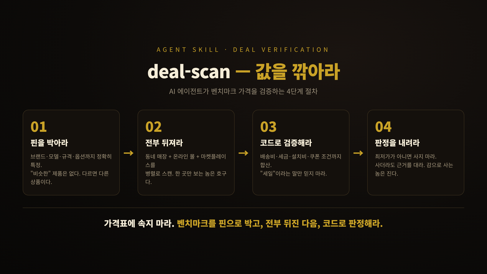

# deal-scan — 한국어 안내

"싸다"는 말에 눈이 멀어 사는 사람이 많다. 비슷해 보이는 제품, 다른 규격, 배송비·세금·설치비를 뺀 가격, 조건 숨긴 쿠폰 — 전부 함정이다. deal-scan은 정확한 상품 하나를 기준점으로 박아두고, 동네 매장부터 온라인 창고까지 전부 뒤진 다음, 감이 아니라 코드로 비교해서 판정까지 내린다.



## 작동 방식

1. **핀을 박아라** — 브랜드, 모델, 규격, 옵션까지 정확히 특정한다. "245/65R17"이 "245/55R19"와 다르다는 걸 모르면 이미 졌다.
2. **전부 뒤져라** — 동네 매장, 온라인 몰, 마켓플레이스까지 병렬로 스캔한다. 한 곳만 보고 판단하지 마라.
3. **코드로 검증해라** — 배송비, 세금, 설치비, 쿠폰 조건까지 전부 합산한다. "세일"이라는 말만 믿지 마라.
4. **판정을 내려라** — 최저가가 아니면 사지 마라. 사더라도 근거를 대라. 감으로 사는 건 진다.

## 쓰는 법

스킬 디렉터리(`deal-scan/`)를 에이전트의 스킬 폴더에 복사하거나, `SKILL.md`를 직접 가리켜라:

```
~/.hermes/skills/<category>/deal-scan/     # Hermes
~/.config/magpie/library/skills/deal-scan/ # Magpie 라이브러리
```

대부분의 에이전트는 `SKILL.md` + YAML 프론트매터만 스캔해서 발견한다. 별도 설정은 필요 없다. 서브에이전트를 쓸 수 있으면 병렬 스캔, 없으면 순차 웹 검색으로 진행한다.

## 주의사항

- **"비슷한" 제품은 없다.** 규격이 다르면 다른 상품이다. 핀을 박기 전에 사지 마라.
- **가격이 싸다고 다 같은 게 아니다.** 보증, 재고, 설치 조건, 반품 규정을 확인해라.
- **한 곳만 뒤지는 건 부족하다.** 빠진 경로는 다시 뒤져라. 조용히 넘어가지 마라.
- **판정 없는 구매는 없다.** 최저가가 아니면 사지 마라. 사더라도 왜 샀는지 설명할 수 있어야 한다.

---

English README: [README.md](README.md) · 스킬 본체: [deal-scan/SKILL.md](deal-scan/SKILL.md)

MIT 라이선스 — [LICENSE](LICENSE) 참조.
