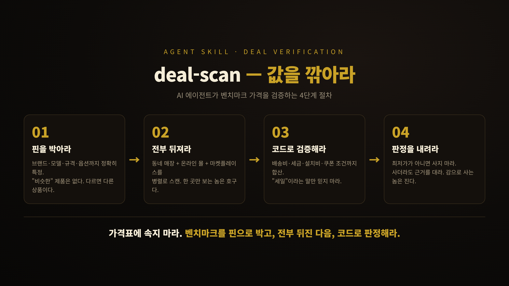

# agent-skills

Agent skills (SKILL.md) for AI agents — portable, agent-agnostic procedures any agent can load and follow.

<details open>
<summary><strong>🇰🇷 한국어</strong></summary>

AI 에이전트용 스킬(SKILL.md) 모음 — 어떤 에이전트든 읽고 따라 할 수 있는 이식 가능한 절차 모음.

## 스킬

- **[deal-scan](deal-scan/SKILL.md)** — 물건을 사기 전에 기준 가격이 진짜 최저인지 검증한다. 정확한 규격을 고정하고, 동네 매장과 온라인을 병렬로 스캔하고, 비교는 코드로 다시 계산해서 판정부터 보고한다. 서브에이전트가 있으면 병렬, 없으면 순차 웹 검색으로 진행한다.



## 사용법

스킬 디렉터리를 에이전트의 스킬 폴더에 복사하거나 `SKILL.md`를 직접 가리켜라:

```
~/.hermes/skills/<category>/<skill-name>/SKILL.md     # Hermes
~/.config/magpie/library/skills/<skill-name>/         # Magpie 라이브러리
```

대부분의 에이전트는 YAML 프론트매터가 있는 `SKILL.md`를 스캔해서 스킬을 발견한다 — 별도 설정 불필요.

## 기여

여기 있는 스킬은 의도적으로 에이전트 비종속적이다: 호스트 전용 경로 없음, 범용이지 않은 도구 이름 없음("web search", "subagents" 같은 표현 사용), 어떤 에이전트든 실행 가능한 절차. 스킬이 내 에이전트에서 안 돌아가면 이슈나 PR을 열어라.

MIT 라이선스 — [LICENSE](LICENSE) 참조.

</details>

<details>
<summary><strong>🇬🇧 English</strong></summary>

## Skills

- **[deal-scan](deal-scan/SKILL.md)** — verify a benchmark price is the best available deal before buying anything. Pins the exact variant, scans local + online vendors in parallel, recomputes comparisons in code, and reports verdict-first. Works with subagents if available, sequential web search if not.

## Use

Copy a skill's directory into your agent's skills folder, or point your agent at the `SKILL.md` directly:

```
~/.hermes/skills/<category>/<skill-name>/SKILL.md     # Hermes
~/.config/magpie/library/skills/<skill-name>/         # Magpie library
```

Most agents discover skills by scanning for `SKILL.md` files with YAML frontmatter — no other wiring needed.

## Contributing

Skills here are kept deliberately agent-agnostic: no host-specific paths, no tool names that aren't universal ("web search", "subagents"), procedures any agent can execute. Open an issue or PR if a skill doesn't work in your agent.

MIT licensed — see [LICENSE](LICENSE).

</details>
